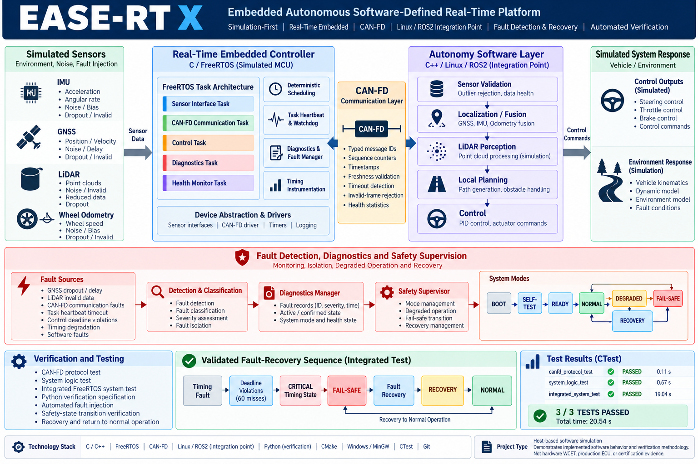

# EASE-RT-X
## Embedded Autonomous Software-Defined Real-Time Platform

**A simulation-first embedded software platform for real-time execution, autonomous-system integration, communication reliability, fault management, and safety supervision.**


---

## 1. Overview

EASE-RT-X is a simulation-first embedded software platform designed to demonstrate practical engineering across real-time embedded software, autonomous-system processing, distributed communication, fault detection, and safety-critical software behaviour.

The platform combines a FreeRTOS-based execution layer with a simulated autonomous software pipeline. Its components interact through a modeled CAN-FD communication layer and simulated sensor inputs.

The central engineering question is:

> **Can an autonomous embedded system detect timing, communication, sensing, and software faults, record diagnostic information, and transition into a safe operating state?**

The project emphasizes fault injection, timing analysis, system observability, and automated verification rather than nominal execution alone.

**Current implementation:** FreeRTOS running through its Windows MSVC-MingW simulation port. Physical hardware deployment and separate Embedded Linux/ROS2 integration are future development targets.

---

## 2. System Architecture

```text
                         EASE-RT-X
                              |
              +---------------+---------------+
              |                               |
       REAL-TIME EXECUTION              AUTONOMY PIPELINE
              |                               |
         C / FreeRTOS                        C / C++
              |                               |
     +--------+---------+            +--------+---------+
     | Communication    |            | Sensor Processing|
     | Control           |            | Localization     |
     | Safety            |            | LiDAR Processing |
     | Monitoring        |            | Planning         |
     | Health Monitoring |            | Controller       |
     +--------+---------+            +--------+---------+
              |                               |
              +----------- CAN-FD ------------+
                              |
                     SIMULATED SENSORS
                              |
                  +-----------+-----------+
                  |           |           |
                 IMU         GNSS        LiDAR
                              |
                       FAULT INJECTION
                              |
                 +------------+------------+
                 |                         |
            DIAGNOSTICS              SAFETY SUPERVISOR
                 |                         |
           Fault Records                FAIL_SAFE
```

### Main Software Components

| Component | Responsibility |
|---|---|
| Communication Task | CAN-FD message exchange and validation |
| Control Task | Periodic control processing |
| Autonomy Task | Sensor processing and autonomy pipeline |
| Safety Task | Safety-related processing |
| Monitoring Task | System health and fault supervision |
| Timing Monitor | Execution duration, task period, jitter, and deadline analysis |
| Timing Fault Manager | Fault severity classification |
| Diagnostic Manager | Fault recording and occurrence tracking |
| Safety Supervisor | System-state management and fail-safe response |

---

## 3. Real-Time Task Architecture

The execution layer separates software responsibilities into periodic FreeRTOS tasks.

| Task | Configured Period | Responsibility |
|---|---:|---|
| Communication | 5 ms | CAN-FD communication |
| Control | 10 ms | Control processing |
| Safety | 10 ms | Safety supervision |
| Autonomy | 20 ms | Autonomous-system processing |
| Monitoring | 100 ms | Health monitoring and fault management |

Implemented capabilities:

- Periodic task execution.
- Task-level separation of responsibilities.
- Task heartbeat monitoring.
- System health evaluation.
- Execution-time measurement.
- Task-period and jitter monitoring.
- Deadline-miss detection.

---

## 4. CAN-FD Communication

The communication subsystem models CAN-FD message exchange between software components.

Implemented capabilities:

- Frame reception and validation.
- Accepted and rejected frame tracking.
- Stale-frame rejection.
- Communication health monitoring.
- Communication fault injection.

The communication task operates independently from the control and autonomy tasks.

---

## 5. Autonomous-System Software Pipeline

The autonomy subsystem models software stages used in autonomous systems.

Implemented components include:

- Simulated sensor processing.
- Localization.
- LiDAR processing.
- Planning.
- Controller logic.
- Sensor fault scenarios.

Fault-injection scenarios include simulated GNSS dropout and invalid LiDAR data.

---

## 6. Timing Monitoring and Fault Management

The timing-monitoring component evaluates task timing using supplied timestamps.

It tracks:

- Elapsed task duration.
- Actual start-to-start period.
- Period jitter.
- Deadline violations.

The timing monitor is implemented as a separate reusable component, allowing its calculations to be tested independently.

### Fault Escalation

The timing fault manager classifies accumulated deadline misses using configured thresholds.

| Deadline Misses | Timing State |
|---:|---|
| 0–2 | OK |
| 3–9 | WARNING |
| 10–49 | DEGRADED |
| 50 or more | CRITICAL |

### Fault-Response Sequence

```text
       CONTROL TASK
             |
             v
     Deadline Violation
             |
             v
       TIMING MONITOR
             |
             v
    TIMING FAULT MANAGER
             |
             v
     CRITICAL CLASSIFICATION
             |
             v
      DIAGNOSTIC RECORDING
             |
             v
      SAFETY SUPERVISOR
             |
             v
          FAIL_SAFE
```

A critical timing fault generates a fault event, is recorded by the diagnostic manager, and triggers the safety supervisor's FAIL_SAFE transition.

---

## 7. Fault Injection and Integration Testing

A deliberate timing fault is introduced into the control task to evaluate the system's response to repeated deadline violations.

The integration test verifies whether the software can:

1. Detect control-task deadline violations.
2. Accumulate timing faults.
3. Escalate the timing state to CRITICAL.
4. Record the fault in the diagnostics subsystem.
5. Transition the safety supervisor into FAIL_SAFE.

### Verified Integration-Test Results

| Metric | Observed Result |
|---|---:|
| Control Task Executions | 690 |
| Control Deadline Misses | 60 |
| Timing State | CRITICAL |
| Diagnostic Records | 1 |
| Safety Mode | FAIL_SAFE |
| CAN-FD Frames Received | 1,383 |
| CAN-FD Frames Accepted | 1,379 |
| CAN-FD Frames Rejected | 4 |
| Integration Test | **PASS** |

### Successful Test Output

```text
INTEGRATION TEST: PASS
Control deadline misses: 60
Timing state: CRITICAL
Diagnostics recorded: 1
Safety mode: FAIL_SAFE
```

These results demonstrate the software-level fault detection and safety-response workflow in the host simulation environment.

---

## 8. Automated Testing

The project includes standalone unit tests and an integrated system test.

| Test | Purpose |
|---|---|
| `canfd_protocol_test` | CAN-FD protocol behaviour |
| `system_logic_test` | System and safety logic |
| `timing_monitor_test` | Timing calculations and deadline detection |
| `integrated_system_test` | Integrated fault-response behaviour |

Run the test suite:

```powershell
ctest --test-dir build --output-on-failure
```

---

## 9. Technology Stack

| Category | Technology |
|---|---|
| Programming Languages | C, C++ |
| Real-Time Operating System | FreeRTOS |
| Build System | CMake |
| Compiler Toolchain | MinGW |
| Communication | Modeled CAN-FD |
| Testing | CTest, custom C++ tests |
| Execution Environment | Windows host simulation |
| Version Control | Git, GitHub |

---

## 10. Build and Run

### Prerequisites

- Windows
- CMake
- MinGW toolchain
- Git
- FreeRTOS Kernel dependency included in the repository

### Clone Repository

```powershell
git clone https://github.com/HARISHIV21/EASE-RT-X.git
cd EASE-RT-X
```

### Configure

```powershell
cmake -S . -B build -G "MinGW Makefiles"
```

### Build

```powershell
cmake --build build -j 4
```

### Run Tests

```powershell
ctest --test-dir build --output-on-failure
```

### Run Application

```powershell
.\build\ease_rt_x.exe --test
```

---

## 11. Engineering Limitations

EASE-RT-X is currently a simulation-first software engineering project.

| Area | Current Status |
|---|---|
| FreeRTOS Task Execution | Implemented using Windows simulation port |
| Timing Monitoring | Implemented and unit tested |
| Deadline Fault Injection | Implemented and integration tested |
| Safety Supervision | Implemented and integration tested |
| Diagnostic Recording | Implemented and integration tested |
| CAN-FD | Software-modeled communication |
| Sensor Inputs | Simulated |
| Physical MCU Deployment | Not yet demonstrated |
| Physical CAN-FD Validation | Not yet demonstrated |
| Embedded Linux / ROS2 Integration | Future integration target |
| Hardware-in-the-Loop Testing | Future development |

**Timing limitation:** Windows host scheduling and the FreeRTOS Windows simulation port do not provide hard real-time guarantees. Measured execution durations and jitter are host-simulation observations, not proof of target-hardware timing performance.

---

## 12. Future Development

Potential next development stages include:

- Porting the real-time software to STM32 or another embedded MCU.
- Integrating a physical CAN-FD interface.
- Validating sensor interfaces on physical hardware.
- Integrating an Embedded Linux and ROS2 autonomy computer.
- Developing hardware-in-the-loop test scenarios.
- Performing target-specific timing and reliability validation.

---

## 13. Engineering Focus

EASE-RT-X explores key engineering principles for dependable autonomous embedded systems:

- Real-time task decomposition.
- Timing measurement and deadline monitoring.
- Communication validation.
- Fault injection and fault escalation.
- Diagnostic observability.
- System health monitoring.
- Safety-state supervision.
- Automated software verification.

The project provides a foundation for further development and validation of dependable autonomous embedded systems.
 
---

## Repository

**GitHub:** [HARISHIV21/EASE-RT-X](https://github.com/HARISHIV21/EASE-RT-X)

**Release Checkpoint:** `v1.0-integration-pass`

**Primary Engineering Focus:** Embedded C/C++, FreeRTOS, CAN-FD, real-time monitoring, fault management, and autonomous-system software.
